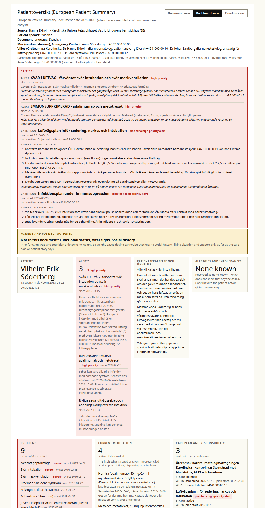
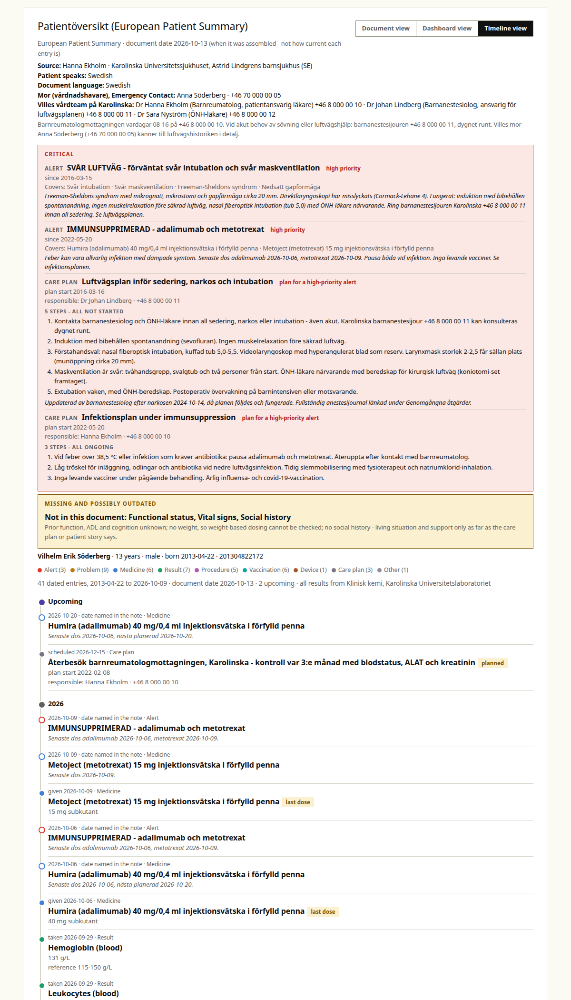

# fhir-document-viewer

A dependency-free web component that renders a FHIR document Bundle - an International
Patient Summary (IPS), a European Patient Summary (EPS) or another EHDS document - the
way a clinician would read it: critical alerts and their care plans first, then what is
missing or possibly outdated, then a dashboard, a timeline or the document section by
section.

**[Live demo](https://vadi2.github.io/fhir-document-viewer/)** - three synthetic
patients, or paste your own Bundle (it stays in your browser).



## Use it

One script tag, no build step, no dependencies:

```html
<script type="module"
  src="https://cdn.jsdelivr.net/gh/vadi2/fhir-document-viewer@0.1.0/fhir-document-viewer.js"></script>

<fhir-document-viewer src="patient-summary.json" view="dashboard"></fhir-document-viewer>
```

Or hand it a Bundle you already have, as JSON text or a parsed object:

```html
<fhir-document-viewer id="viewer"></fhir-document-viewer>
<script type="module">
  const response = await fetch("https://example.org/fhir/Bundle/123");
  document.getElementById("viewer").bundle = await response.text();
</script>
```

Or put the Bundle in the page itself:

```html
<fhir-document-viewer>
  <script type="application/fhir+json">{ "resourceType": "Bundle", "type": "document", ... }</script>
</fhir-document-viewer>
```

Everything happens in the browser. The component makes no network request other than
fetching the `src` you give it, and loads no fonts, scripts or styles of its own.

[examples/minimal.html](examples/minimal.html) is a complete page.

### Without a CDN

Copy `fhir-document-viewer.js` and the `src/` folder next to your page and point the
script tag at your copy, or install straight from GitHub (the package is not on the npm
registry yet):

```bash
npm install github:vadi2/fhir-document-viewer
```

```js
import "fhir-document-viewer";                       // defines <fhir-document-viewer>
import { read, renderHtml } from "fhir-document-viewer"; // or use the functions
```

## The three views

| `view` | What it shows |
|---|---|
| `document` (default) | The patient, then every section of the document in its own order, each entry with its status, dates and details. |
| `dashboard` | One card per clinical question: patient, alerts, the patient's own story, allergies, problems, current medication, care plans and who is responsible, results and how old they are, devices, procedures, vaccinations, plus which patient summary sections the document covers and technical checks on its entries. |
| `timeline` | Every dated entry in one column: upcoming ones first (soonest on top), then newest to oldest under year headings, colour-coded by kind. |

Two boxes are pinned above every view:

- **Critical** - high-priority alerts (FHIR `Flag`), each followed by the care plan
  that answers it with its steps and who is responsible; high-criticality allergies;
  high-risk problems; anticoagulants and insulin with what dosing them needs (last dose,
  renal function, weight) and whether the document has it.
- **Missing and possibly outdated** - sections a reader would expect that are absent,
  results too old to act on, a medication list that was never reconciled, cancelled
  follow-ups, and other gaps, each with why it matters.



## Document types

The type is read off the Bundle (its profile, the Composition's LOINC type, or its
content), never asked for.

| Document | Recognised by | What the viewer does with it |
|---|---|---|
| **Patient summary** - IPS, HL7 Europe EPS, national IPS profiles | Composition type LOINC `60591-5`, or the EPS Bundle profile | The full treatment: all three views, the critical box, and the missing-and-outdated box checked against the sections a patient summary should have. This is what the viewer was built for. |
| **Laboratory report** - HL7 Europe Laboratory | Composition type LOINC `11502-2`, or the EU laboratory Bundle profile | Results grouped under their section, sub-sections ("Blood examinations") kept as labels, each with value, unit, reference range, interpretation and performer. Timeline by result date. |
| **Prescription and dispense** - HL7 Europe MPD | An entry claiming an MPD profile, or a `MedicationRequest` or `MedicationDispense` in a Bundle with no Composition | There is no Composition, so the entries are listed as they come, each medication with its dosage, status and dates. Anticoagulants and insulin still reach the critical box. |
| **Imaging report** - HL7 Europe Imaging | The EU imaging Bundle profiles, or an `ImagingStudy` among the entries | Its sections with their narrative as written, and observations read as results. `ImagingStudy` and `DiagnosticReport` get no treatment of their own: they are listed by type and name, and no images are shown. |
| **Hospital discharge report** - HL7 Europe HDR | Composition type LOINC `34105-7`, or the EU discharge report Bundle profiles | Read like a patient summary: its sections, with problems, medication, procedures and the plan of care in all three views. |

Anything else that is a FHIR Bundle is shown as a patient summary would be: whatever
Composition, sections and resources it has are rendered, and the rest is listed as
missing. A Bundle with no Composition at all still shows its patient and its entries.

Written against FHIR R4. Sections are matched by LOINC code first and by title second, so
documents in any language work; the three examples are in Swedish.

## Element reference

**Attributes**

| Attribute | Values | |
|---|---|---|
| `src` | URL | A Bundle to fetch and show. |
| `view` | `document`, `dashboard`, `timeline` | Which view to open on. Changes when the reader uses the buttons. |
| `switcher` | `off` | Hide the view buttons. |
| `caption` | text | A short note shown with the document type and date, for example where the document came from. |
| `theme` | `light`, `dark` | Pin the colour scheme. Without it the viewer follows the page's `color-scheme`. |
| `today` | `YYYY-MM-DD` | The day ages and "upcoming" are counted from when the document carries no date. Defaults to the current day. |

**Properties** - `bundle` (JSON text, a parsed Bundle, or `null`), `view`, `caption`,
and read-only `summary` (the view model) and `docType` (`eps`, `laboratory`, `mpd`,
`imaging`, `hdr`).

**Events** - `render` (`detail: { docType, summary, view }`), `error`
(`detail: { message }`, for example "Not a FHIR Bundle in JSON"), `viewchange`
(`detail: { view }`, bubbles).

**Styling** - the viewer lives in a shadow root, so page styles do not leak in. Change
its look with custom properties on the element or any ancestor:

```css
fhir-document-viewer {
  --fdv-font: "Inter", sans-serif;   /* font family */
  --fdv-font-size: 15px;             /* base size everything scales from */
  --fdv-font-weight: 400;
  --fdv-radius: 6px;
  --fdv-accent: #0b5fff;
  --fdv-frame: none;                 /* the border around the whole viewer */
  --fdv-padding: 0;
}
```

Colours: `--fdv-bg`, `--fdv-card`, `--fdv-text`, `--fdv-muted`, `--fdv-border`,
`--fdv-field-border`, `--fdv-accent`, `--fdv-accent-soft`, `--fdv-btn`, `--fdv-btn-on`,
`--fdv-pass`, `--fdv-pass-bg`, `--fdv-fail`, `--fdv-fail-bg`, `--fdv-warn`,
`--fdv-warn-bg`, `--fdv-code-bg`. The outer frame is also exposed as `::part(frame)`.

## JavaScript API

```js
import { read, renderHtml, renderStatic, summarize, detectDocumentType, parseJson, css }
  from "https://cdn.jsdelivr.net/gh/vadi2/fhir-document-viewer@0.1.0/fhir-document-viewer.js";

const doc = read(jsonText);            // { docType, summary } - throws TypeError if not a Bundle
doc.summary.attention;                 // what is missing or possibly outdated
doc.summary.sections;                  // every section with its entries, read into plain objects

renderHtml(jsonText, { view: "timeline" });  // an HTML string, without the stylesheet
renderStatic(jsonText, { view: "dashboard" }); // a whole element with a declarative
                                               // shadow root: displays without any script
```

The functions have no DOM dependency and run in Node 20+, Deno, Bun and workers, so the
same module can pre-render on a server. Everything from the document is HTML-escaped
before it is placed in the page.

Give it the JSON **text** when you can: FHIR decimals carry their precision ("5.0" is not
"5"), and only the text still has it. `parseJson` keeps it on engines that expose the
source to `JSON.parse` revivers (Chrome 114+, Firefox 135+, Safari 18.4+, Node 21+);
elsewhere, and for already parsed objects, "5.0" is shown as "5".

## Limits

- **A reading aid, not a medical device.** It is not certified for clinical use and
  must not be the basis for a clinical decision. What it marks critical or missing is a
  heuristic over what the document says.
- **Not a validator.** It shows what is there, tolerates malformed input and says
  nothing about conformance to a profile. Validate separately.
- **No terminology server.** Codes are shown by the `display` and `text` the document
  carries. Anticoagulants and insulin are recognised by ATC code only, and high-risk
  problems by a short list of diagnosis names in English, Swedish, Danish, Norwegian
  and German. A medicine coded only in a national system is not flagged.
- **Interface text is English.** Document content is shown in whatever language it was
  written in; the labels around it are not translated.
- **JSON only**, FHIR R4. No XML, no STU3, no signature checking, no attachments
  rendered (PDFs and images are listed, not shown).
- **One document at a time.** It does not merge, compare or reconcile documents.
- Needs a browser with custom elements and shadow DOM (anything from 2020). Dark mode
  uses `light-dark()` (2024); older browsers get the light palette.

## Development

```bash
node --test
```

No install step: there are no dependencies. The tests render the three example
documents and assert on what a reader must see (critical first, then missing and
outdated, then the view; timeline order), compare the view model with Provbana's own
output for nine documents (`test/golden/`), and replay 320 cases captured from
Provbana's test suite, most of them malformed on purpose (`test/corpus/`).

To look at it locally, serve the folder with any static server and open `index.html`:

```bash
python3 -m http.server 8000
```

Every patient in `samples/` and `test/` is synthetic. See
[test/fixtures/README.md](test/fixtures/README.md) for where each file comes from.

## Credit

This is the clinical view of [Provbana](https://github.com/vadi2/Provbana), an open
source platform for FHIR document tracks at hackathons and connectathons, first used at
the European Patient Summary track of the Nordic Hackathon 2026. The view was written
there, where it renders every submitted document; this repository is the same view as
a component of its own. The three example patients (Andrea, Arne and Ville) are
Provbana's scenario documents.

[MIT](LICENSE)
